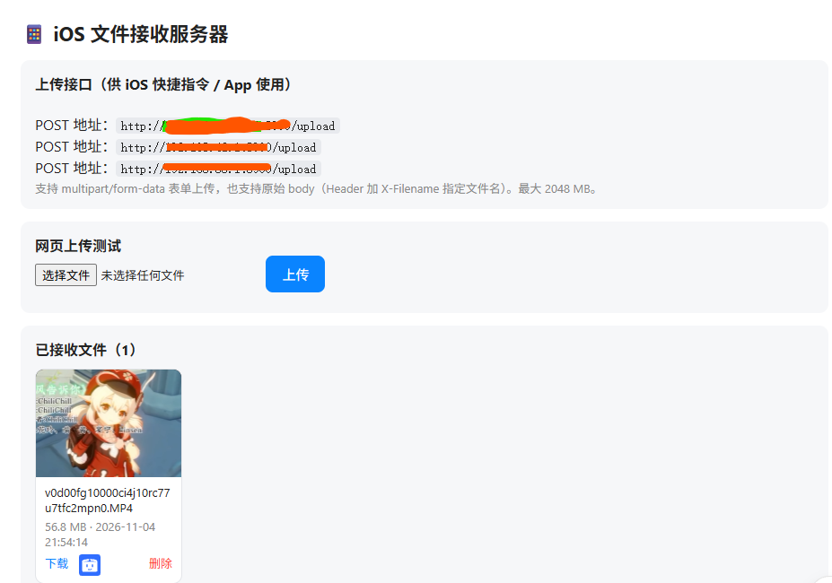
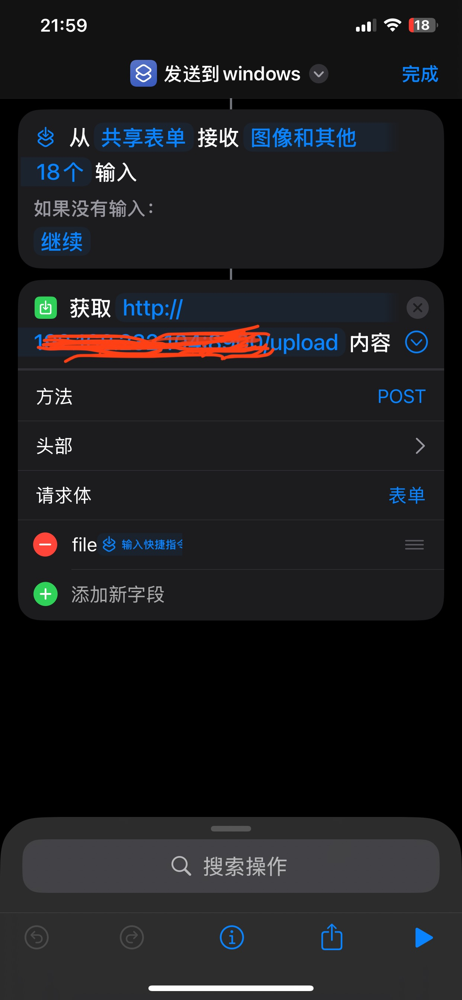

# 📱 iOS 文件接收服务器

基于 Flask 的局域网 HTTP 文件接收服务器：iPhone / iPad 通过「快捷指令」或任意 HTTP 客户端把照片、视频、文件传到 Windows 电脑，并可在网页上直接预览图片与视频。

## 界面预览

电脑浏览器打开 `http://127.0.0.1:8900` 即可看到管理页面：上方显示 iOS 上传地址，中部可直接网页上传测试，下方以缩略图网格展示已接收的文件——图片直接显示画面、视频显示首帧，点击任意缩略图可放大预览或播放：



## 功能

- ✅ 接收 multipart 表单上传 / 原始 body 上传（单文件最大 2GB）
- ✅ 网页端：上传测试、图片缩略图、视频首帧预览、点击放大灯箱播放、下载、删除
- ✅ 同名文件自动加时间戳防覆盖，文件名安全过滤
- ✅ REST 接口：列表 / 下载 / 删除

## 环境要求

只需安装 **Python 3.10+**（安装时勾选 "Add Python to PATH"，[下载地址](https://www.python.org/downloads/)）。

Flask 依赖的安装两种方式二选一：**自动**——启动脚本首次运行时自动检测并安装；**手动**——自己执行 `pip install -r requirements.txt`。

## 如何运行

### 方式一：自动运行——双击「启动服务.bat」（推荐，零配置）

双击项目根目录里的 `启动服务.bat`，脚本会自动完成全部部署工作：

| 步骤 | 脚本自动做的事 |
|---|---|
| 1 | 检查 Python 环境，缺失时提示并给出下载地址 |
| 2 | 检查 Flask 依赖，首次运行自动执行 `pip install -r requirements.txt` |
| 3 | 启动服务器，显示 iOS 上传地址（关闭黑色窗口即停止服务） |

也就是说：**下载项目 → 装好 Python → 双击 bat，三步就能跑起来。**

### 方式二：手动运行——命令行

在项目根目录打开 PowerShell，依次执行：

```powershell
# 1. 安装依赖（只需一次）
pip install -r requirements.txt

# 2. 启动服务器
python app.py
```

启动成功的标志：控制台显示 `iOS 上传地址: http://...`，且电脑浏览器打开 `http://127.0.0.1:8900` 能看到管理页面。按 `Ctrl+C` 或关闭窗口即停止服务。

### 方式三：桌面快捷批处理

双击桌面上的「ios传输专用.bat」，效果与方式一相同。

启动后控制台会显示本机局域网 IP，例如：

```
iOS 上传地址: http://192.168.232.104:8900/upload
```

- 服务器监听 `0.0.0.0:8900`，改端口只需修改 `app.py` 顶部的 `PORT = 8900`
- 收到的文件保存在 `uploads\` 目录
- 电脑浏览器打开 `http://127.0.0.1:8900` 可查看/预览已接收的文件

## 如何配置 iOS 手机

前提：iPhone 与电脑连接**同一个 Wi-Fi / 局域网**。

### 方法一：快捷指令（推荐）

下图是配置好的快捷指令「发送到 windows」：从共享表单接收照片、视频或任意文件，以 POST 表单方式发送到服务器的 `/upload` 接口，在相册、文件等 App 里点「共享」即可一键传到电脑。



配置步骤：

1. 打开 iPhone 上的「快捷指令」App → 新建快捷指令，命名为如「发送到 windows」
2. 添加操作 **「从共享表单接收」**，接收类型设为「图像和其他」
3. 添加操作 **「获取 URL 的内容」**，配置为：
   - 方法：**POST**
   - URL：`http://<电脑IP>:8900/upload`（IP 以服务器启动时显示的为准）
   - 展开「请求体」→ 选 **「表单」** → 字段名填 `file`，值选 **「快捷指令输入」** 变量
4. 在快捷指令详情设置中开启 **「显示在"共享"表中」**
5. 使用：在相册/文件 App 选中文件 → 点「共享」→ 选择「发送到 windows」，即完成上传

### 方法二：原始 body 上传（适合 App / 脚本）

把文件二进制直接作为请求体，用 Header 指定保存的文件名：

```bash
curl -X POST -H "X-Filename: photo.jpg" --data-binary @photo.jpg http://192.168.232.104:8900/upload
```

## HTTP 接口

| 方法 | 路径 | 说明 |
|---|---|---|
| GET | `/` | 网页首页（上传 + 预览） |
| POST / PUT | `/upload` | 接收文件 |
| GET | `/files` | JSON 文件列表 |
| GET | `/files/<名称>` | 下载文件 |
| GET | `/preview/<名称>` | 内联预览（图片/视频） |
| DELETE | `/files/<名称>` | 删除文件 |

## 常见问题

- **iPhone 连不上**：确认两者在同一局域网；Windows 防火墙需放行 8900 端口（首次运行弹窗时选「专用网络允许」），或手动添加规则：
  ```powershell
  New-NetFirewallRule -DisplayName "iOS File Server" -Direction Inbound -LocalPort 8900 -Protocol TCP -Action Allow -Profile Private
  ```
- **HEIC 照片网页里显示不出来**：Windows 版 Chrome/Edge 可能不支持 HEIC，页面会显示占位图标，点击后仍可下载原图
- **电脑 IP 变了**：以服务器启动时控制台显示的地址为准
